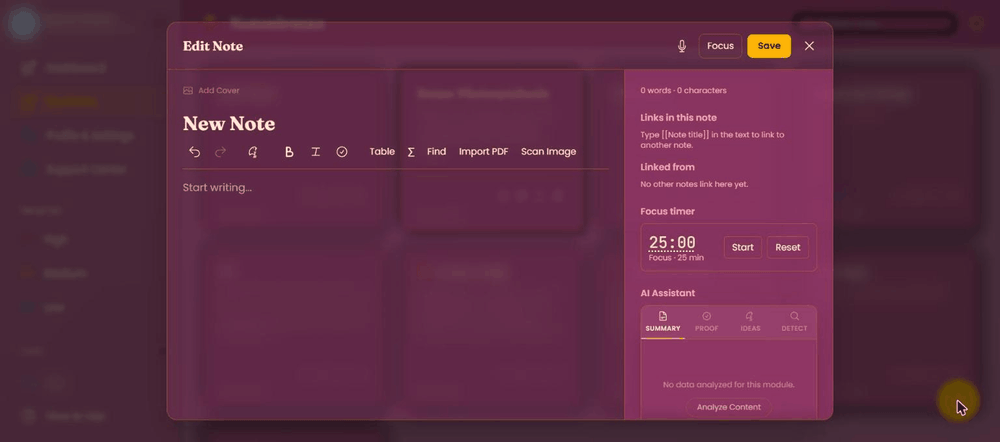
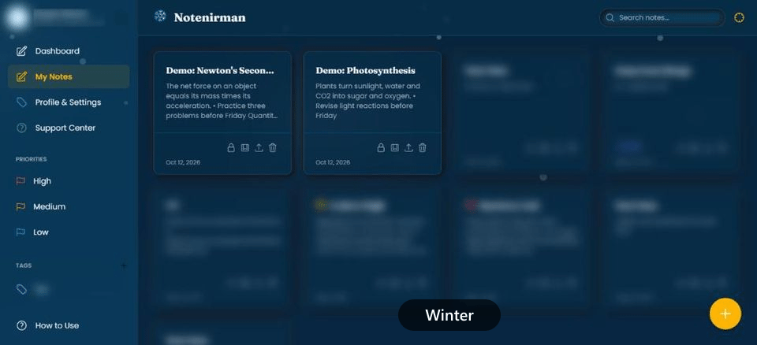
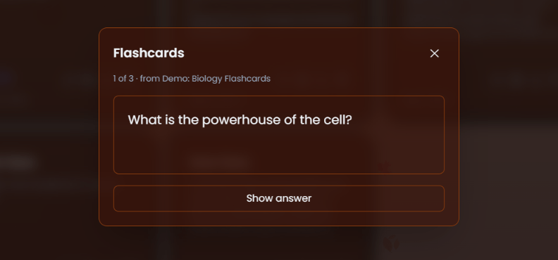

# NoteNirman 🪔

[](LICENSE.md)
[](https://react.dev/)
[](https://www.typescriptlang.org/)
[](https://vitejs.dev/)
[](https://supabase.com/)

An offline-first notes app for students, for Windows, Android and the web.
Notes save to the device first; syncing to the cloud is a background
convenience, never a requirement — write on your phone, and it's waiting
for you on your desktop next time you have a connection, even if the phone
died in between. Free to use. Themed around the four seasons and Indian
festivals (Diwali, Holi, Navratri, Pongal, Independence Day, and more).

> **Status:** early release (v0.1.x). Use the web app at <https://notenirman.vercel.app>, or
> install the Windows app or Android APK from [GitHub Releases](https://github.com/Rhytam23/note-saver/releases/latest).
> The Android APK is installed outside the Play Store, so Android will ask you to allow it. The optional
> AI assistant runs through Supabase Edge Functions, so if you host the backend yourself you supply your own
> Gemini API key: see [docs/SETUP.md](docs/SETUP.md). The reasoning behind the project is in
> [docs/DECISIONS.md](docs/DECISIONS.md).

## See it in action

Recorded from the live app at <https://notenirman.vercel.app> (other notes blurred).

**Write with checklists, equations and tables**



**13 seasonal themes, switched automatically by date or picked by hand**



**Flashcards from plain text: write `Question:: Answer` on any line**



## Features

- **Offline-first**: every note is written to the device first (IndexedDB),
  synced to Supabase in the background when online. The web app is
  installable as a PWA and keeps working fully offline after the first
  visit.
- **Editor**: TipTap-based rich text — headings, lists, checklists, tables,
  LaTeX equations, code blocks, callouts, cover images, voice dictation,
  find-in-note, focus mode, a Pomodoro timer.
- **Study tools**: flashcards with spaced repetition (write
  `Question:: Answer` in any note), five starter templates, notebooks
  grouped by subject/chapter, `[[wiki links]]` with backlinks and a visual
  connections graph.
- **Real import, not a stub**: on-device PDF text extraction and on-device
  OCR (photo/screenshot → text) — files are never uploaded to a server for
  this.
- **Optional AI assistant** (Google Gemini): summarize, proofread, generate
  ideas, detect AI-written text. The app works fully without it, and the
  API key never reaches the client — it's proxied through a Supabase Edge
  Function.
- **Security**: per-note passphrase lock (AES-256-GCM); sync over an
  encrypted connection to a private, per-user database (Postgres Row Level
  Security). A forgotten note passphrase cannot be recovered — that's by
  design.
- **Data control**: export any note as PDF/Markdown/text, back up the whole
  workspace to one file and restore it later, import from Markdown, HTML,
  text or CSV.
- **Telegram bot (optional)**: write, search and manage notes from Telegram with over 40 commands
  (`/quick`, `/search`, `/todo`, `/remind`, `/quiz`, `/summarize` and more), plus reminders and a
  quick-capture inbox. It reads and writes the same notes as the apps, so everything syncs. Try it at
  [@notenirman_bot](https://t.me/notenirman_bot) (link it from Profile > Telegram in the app), or host your
  own on Supabase with your own bot token: see [telegram/README.md](telegram/README.md).
- **13 seasonal themes**, switched automatically by date/location or picked
  manually.

## Platforms

| Platform | How | Status |
| :--- | :--- | :--- |
| Web | Vite build, installable as a PWA | Works |
| Windows | Tauri 2 desktop app | Installer builds locally; not code-signed |
| Android | Capacitor 8 app | APK on [GitHub Releases](https://github.com/Rhytam23/note-saver/releases/latest) (sideloaded, not on the Play Store) |

## Quick start

```bash
git clone https://github.com/Rhytam23/note-saver.git
cd note-saver
npm install
cp .env.example .env   # fill in your Supabase project details
npm run dev              # http://localhost:3000
```

```bash
npx tsc --noEmit   # type check
npm run lint        # eslint
npm test             # vitest — 463 tests as of 2026-09-22
npm run build         # production build
```

Full setup, including the Windows and Android builds and the Supabase
backend, is in [docs/SETUP.md](docs/SETUP.md).

## Project structure

```text
note-nirman/
├── src/
│   ├── App.tsx           # app shell
│   ├── components/        # UI — NoteEditor.tsx is the live TipTap editor
│   ├── services/            # business logic — sync engine, local storage, features
│   ├── contexts/, hooks/, extensions/, config/, types.ts
├── supabase/                # Postgres migrations + Edge Functions
├── telegram/                # Telegram bot: function source, migrations, in-app linking, tests
├── src-tauri/                 # Windows desktop shell (Tauri)
├── android/                    # Android shell (Capacitor)
├── public/                      # static assets, PWA manifest/service worker, SEO files
└── docs/                          # architecture, setup, roadmap, decision log — see below
```

Not everything under `src/` is live — a sizeable subsystem (block editor,
real-time collaboration, semantic search) was built in an earlier pass and
kept but never wired in. Before assuming a file is used just because it
exists, see [docs/DORMANT-CODE.md](docs/DORMANT-CODE.md).

## Documentation

Start at [docs/README.md](docs/README.md) — it's the index and reading
order for everything below:

- [docs/ARCHITECTURE.md](docs/ARCHITECTURE.md) — how the app actually works
- [docs/DORMANT-CODE.md](docs/DORMANT-CODE.md) — what's in the repo but not running
- [docs/SETUP.md](docs/SETUP.md) — full build/dev/deploy guide, all platforms
- [docs/ROADMAP.md](docs/ROADMAP.md) — feature roadmap status
- [docs/DECISIONS.md](docs/DECISIONS.md) — dated log of why things are the way they are
- [docs/history/](docs/history/) — superseded documents, kept for the trail

## License

NoteNirman is **source-available**, not open source: you can read, run, fork and learn from it, but only for non-commercial use.

- **Code:** [PolyForm Noncommercial 1.0.0](LICENSE.md). Personal, educational, research and other non-commercial use is welcome. Commercial use is reserved to the author; ask for a commercial licence.
- **Name, logo, icons, visual design and media:** © Rhytam Biswas, all rights reserved. See [LICENSE-ASSETS.md](LICENSE-ASSETS.md) for the details. Sharing a fork? Give it your own name and logo.
