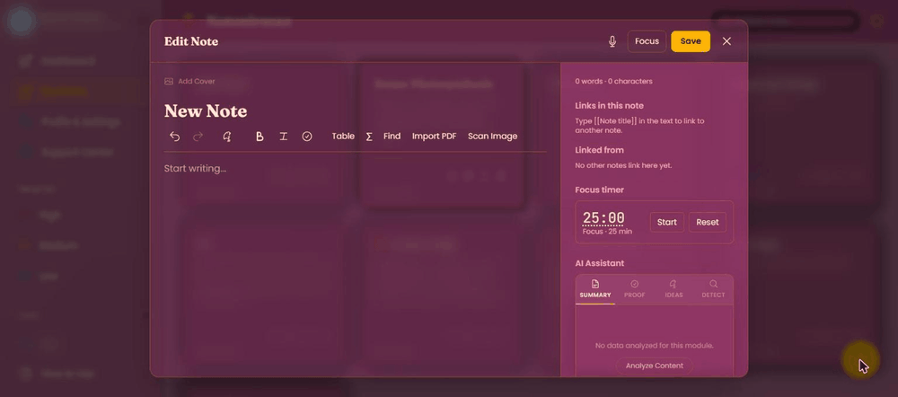
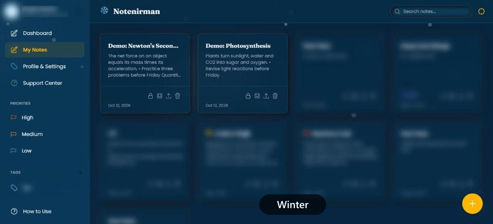
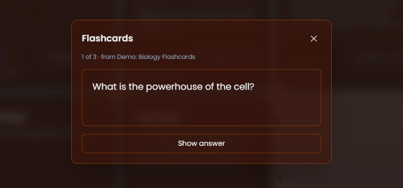

<!-- Improved compatibility of back to top link: See: https://github.com/othneildrew/Best-README-Template/pull/73 -->
<a id="readme-top"></a>

<!-- PROJECT SHIELDS -->
[![Contributors][contributors-shield]][contributors-url]
[![Forks][forks-shield]][forks-url]
[![Stargazers][stars-shield]][stars-url]
[![Issues][issues-shield]][issues-url]
[![PolyForm Noncommercial][license-shield]][license-url]


<!-- PROJECT LOGO -->
<br />
<div align="center">
  <a href="https://github.com/Rhytam23/note-saver">
    
  </a>

<h3 align="center">NoteNirman 🪔</h3>

  <p align="center">
    A free, offline-first notes app for students. Web, Windows, Android and Telegram, with sync, tags and math.
    <br />
    <a href="docs/README.md"><strong>Explore the docs »</strong></a>
    <br />
    <br />
    <a href="https://notenirman.vercel.app">View Demo</a>
    &middot;
    <a href="https://github.com/Rhytam23/note-saver/issues/new?labels=bug">Report Bug</a>
    &middot;
    <a href="https://github.com/Rhytam23/note-saver/issues/new?labels=enhancement">Request Feature</a>
  </p>
</div>


<!-- TABLE OF CONTENTS -->
<details>
  <summary>Table of Contents</summary>
  <ol>
    <li>
      <a href="#about-the-project">About The Project</a>
      <ul>
        <li><a href="#see-it-in-action">See It In Action</a></li>
        <li><a href="#features">Features</a></li>
        <li><a href="#platforms">Platforms</a></li>
        <li><a href="#built-with">Built With</a></li>
      </ul>
    </li>
    <li>
      <a href="#getting-started">Getting Started</a>
      <ul>
        <li><a href="#prerequisites">Prerequisites</a></li>
        <li><a href="#installation">Installation</a></li>
      </ul>
    </li>
    <li><a href="#usage">Usage</a></li>
    <li><a href="#project-structure">Project Structure</a></li>
    <li><a href="#roadmap">Roadmap</a></li>
    <li><a href="#contributing">Contributing</a></li>
    <li><a href="#license">License</a></li>
    <li><a href="#contact">Contact</a></li>
  </ol>
</details>


<!-- ABOUT THE PROJECT -->
## About The Project

An offline-first notes app for students, for Windows, Android and the web.
Notes save to the device first; syncing to the cloud is a background
convenience, never a requirement. Write on your phone, and it's waiting
for you on your desktop next time you have a connection, even if the phone
died in between. Free to use. Themed around the four seasons and Indian
festivals (Diwali, Holi, Navratri, Pongal, Independence Day, and more).

> **Status:** early release (v0.1.x). Use the web app at <https://notenirman.vercel.app>, or
> install the Windows app or Android APK from [GitHub Releases](https://github.com/Rhytam23/note-saver/releases/latest).
> The Android APK is installed outside the Play Store, so Android will ask you to allow it. The optional
> AI assistant runs through Supabase Edge Functions, so if you host the backend yourself you supply your own
> Gemini API key: see [docs/SETUP.md](docs/SETUP.md). The reasoning behind the project is in
> [docs/DECISIONS.md](docs/DECISIONS.md).

### See It In Action

Recorded from the live app at <https://notenirman.vercel.app> (other notes blurred).

**Write with checklists, equations and tables**



**13 seasonal themes, switched automatically by date or picked by hand**



**Flashcards from plain text: write `Question:: Answer` on any line**



### Features

- **Offline-first**: every note is written to the device first (IndexedDB),
  synced to Supabase in the background when online. The web app is
  installable as a PWA and keeps working fully offline after the first
  visit.
- **Editor**: TipTap-based rich text with headings, lists, checklists, tables,
  LaTeX equations, code blocks, callouts, cover images, voice dictation,
  find-in-note, focus mode and a Pomodoro timer.
- **Study tools**: flashcards with spaced repetition (write
  `Question:: Answer` in any note), five starter templates, notebooks
  grouped by subject/chapter, `[[wiki links]]` with backlinks and a visual
  connections graph.
- **Real import, not a stub**: on-device PDF text extraction and on-device
  OCR (photo/screenshot to text). Files are never uploaded to a server for
  this.
- **Optional AI assistant** (Google Gemini): summarize, proofread, generate
  ideas, detect AI-written text. The app works fully without it, and the
  API key never reaches the client; it's proxied through a Supabase Edge
  Function.
- **Security**: per-note passphrase lock (AES-256-GCM); sync over an
  encrypted connection to a private, per-user database (Postgres Row Level
  Security). A forgotten note passphrase cannot be recovered. That's by
  design.
- **Data control**: export any note as PDF/Markdown/text, back up the whole
  workspace to one file and restore it later, import from Markdown, HTML,
  text or CSV.
- **Telegram bot (optional)**: write, search and manage notes from Telegram with over 40 commands
  (`/quick`, `/search`, `/todo`, `/remind`, `/quiz`, `/summarize` and more), plus reminders and a
  quick-capture inbox. It reads and writes the same notes as the apps, so everything syncs. Try it at
  [@notenirman_bot](https://t.me/notenirman_bot) (link it from Profile > Telegram in the app), or host your
  own on Supabase with your own bot token: see [telegram/README.md](telegram/README.md).
- **13 seasonal themes**, switched automatically by date and timezone or picked
  manually.

### Platforms

| Platform | How | Status |
| :--- | :--- | :--- |
| Web | Vite build, installable as a PWA | Works |
| Windows | Tauri 2 desktop app | Installer builds locally; not code-signed |
| Android | Capacitor 8 app | APK on [GitHub Releases](https://github.com/Rhytam23/note-saver/releases/latest) (sideloaded, not on the Play Store) |

<p align="right">(<a href="#readme-top">back to top</a>)</p>


### Built With

* [![React][React.js]][React-url]
* [![TypeScript][TypeScript.com]][TypeScript-url]
* [![Vite][Vite.dev]][Vite-url]
* [![Tailwind CSS][Tailwind.css]][Tailwind-url]
* [![Supabase][Supabase.com]][Supabase-url]
* [![Tauri][Tauri.app]][Tauri-url]
* [![Capacitor][Capacitor.js]][Capacitor-url]

<p align="right">(<a href="#readme-top">back to top</a>)</p>


<!-- GETTING STARTED -->
## Getting Started

To get a local copy up and running, follow these steps. Full setup, including the Windows and Android builds and the Supabase
backend, is in [docs/SETUP.md](docs/SETUP.md).

### Prerequisites

* Node.js and npm
  ```sh
  npm install npm@latest -g
  ```
* A Supabase project (for sync and auth)

### Installation

1. Clone the repo
   ```sh
   git clone https://github.com/Rhytam23/note-saver.git
   cd note-saver
   ```
2. Install NPM packages
   ```sh
   npm install
   ```
3. Copy the example env file and fill in your Supabase project details
   ```sh
   cp .env.example .env
   ```
4. Start the dev server at `http://localhost:3000`
   ```sh
   npm run dev
   ```

<p align="right">(<a href="#readme-top">back to top</a>)</p>


<!-- USAGE EXAMPLES -->
## Usage

Open the web app at <https://notenirman.vercel.app>, or run it locally as above.

Handy scripts while developing:

```sh
npx tsc --noEmit   # type check
npm run lint       # eslint
npm test           # vitest, 622 tests as of 2026-10-27
npm run build      # production build
```

_For more, please refer to the [Documentation](docs/README.md)._

The docs index (`docs/README.md`) gives the reading order for everything:

- [docs/ARCHITECTURE.md](docs/ARCHITECTURE.md): how the app actually works
- [docs/DORMANT-CODE.md](docs/DORMANT-CODE.md): what's in the repo but not running
- [docs/SETUP.md](docs/SETUP.md): full build/dev/deploy guide, all platforms
- [docs/ROADMAP.md](docs/ROADMAP.md): feature roadmap status
- [docs/DECISIONS.md](docs/DECISIONS.md): dated log of why things are the way they are
- [docs/history/](docs/history/): superseded documents, kept for the trail

<p align="right">(<a href="#readme-top">back to top</a>)</p>


<!-- PROJECT STRUCTURE -->
## Project Structure

```text
note-nirman/
├── src/
│   ├── App.tsx           # app shell
│   ├── components/       # UI; NoteEditor.tsx is the live TipTap editor
│   ├── services/         # business logic: sync engine, local storage, features
│   ├── contexts/, hooks/, extensions/, config/, types.ts
├── supabase/             # Postgres migrations + Edge Functions
├── telegram/             # Telegram bot: function source, migrations, in-app linking, tests
├── src-tauri/            # Windows desktop shell (Tauri)
├── android/              # Android shell (Capacitor)
├── public/               # static assets, PWA manifest/service worker, SEO files
└── docs/                 # architecture, setup, roadmap, decision log
```

Not everything under `src/` is live. A sizeable subsystem (block editor,
real-time collaboration, semantic search) was built in an earlier pass and
kept but never wired in. Before assuming a file is used just because it
exists, see [docs/DORMANT-CODE.md](docs/DORMANT-CODE.md).

<p align="right">(<a href="#readme-top">back to top</a>)</p>


<!-- ROADMAP -->
## Roadmap

See [docs/ROADMAP.md](docs/ROADMAP.md) for the feature roadmap status, and the
[open issues](https://github.com/Rhytam23/note-saver/issues) for a full list of proposed features (and known issues).

<p align="right">(<a href="#readme-top">back to top</a>)</p>


<!-- CONTRIBUTING -->
## Contributing

Contributions are what make the open source community such an amazing place to learn, inspire, and create. Any contributions you make are **greatly appreciated**.

If you have a suggestion that would make this better, please fork the repo and create a pull request. You can also simply open an issue with the tag "enhancement".
Don't forget to give the project a star! Thanks again! See [CONTRIBUTING.md](CONTRIBUTING.md) for the details.

1. Fork the Project
2. Create your Feature Branch (`git checkout -b feature/AmazingFeature`)
3. Commit your Changes (`git commit -m 'Add some AmazingFeature'`)
4. Push to the Branch (`git push origin feature/AmazingFeature`)
5. Open a Pull Request

<p align="right">(<a href="#readme-top">back to top</a>)</p>


<!-- LICENSE -->
## License

NoteNirman is **source-available**, not open source: you can read, run, fork and learn from it, but only for non-commercial use.

- **Code:** [PolyForm Noncommercial 1.0.0](LICENSE.md). Personal, educational, research and other non-commercial use is welcome. Commercial use is reserved to the author; ask for a commercial licence.
- **Name, logo, icons, visual design and media:** © Rhytam Biswas, all rights reserved. See [LICENSE-ASSETS.md](LICENSE-ASSETS.md) for the details. Sharing a fork? Give it your own name and logo.

<p align="right">(<a href="#readme-top">back to top</a>)</p>


<!-- CONTACT -->
## Contact

Rhytam Biswas - [@Rhytam23](https://github.com/Rhytam23)

Project Link: [https://github.com/Rhytam23/note-saver](https://github.com/Rhytam23/note-saver)

<p align="right">(<a href="#readme-top">back to top</a>)</p>


<!-- MARKDOWN LINKS & IMAGES -->
[contributors-shield]: https://img.shields.io/github/contributors/Rhytam23/note-saver.svg?style=for-the-badge
[contributors-url]: https://github.com/Rhytam23/note-saver/graphs/contributors
[forks-shield]: https://img.shields.io/github/forks/Rhytam23/note-saver.svg?style=for-the-badge
[forks-url]: https://github.com/Rhytam23/note-saver/network/members
[stars-shield]: https://img.shields.io/github/stars/Rhytam23/note-saver.svg?style=for-the-badge
[stars-url]: https://github.com/Rhytam23/note-saver/stargazers
[issues-shield]: https://img.shields.io/github/issues/Rhytam23/note-saver.svg?style=for-the-badge
[issues-url]: https://github.com/Rhytam23/note-saver/issues
[license-shield]: https://img.shields.io/badge/License-PolyForm%20Noncommercial-orange.svg?style=for-the-badge
[license-url]: https://github.com/Rhytam23/note-saver/blob/main/LICENSE.md
[React.js]: https://img.shields.io/badge/React-20232A?style=for-the-badge&logo=react&logoColor=61DAFB
[React-url]: https://reactjs.org/
[TypeScript.com]: https://img.shields.io/badge/TypeScript-3178C6?style=for-the-badge&logo=typescript&logoColor=white
[TypeScript-url]: https://www.typescriptlang.org/
[Vite.dev]: https://img.shields.io/badge/Vite-646CFF?style=for-the-badge&logo=vite&logoColor=white
[Vite-url]: https://vitejs.dev/
[Tailwind.css]: https://img.shields.io/badge/Tailwind_CSS-06B6D4?style=for-the-badge&logo=tailwindcss&logoColor=white
[Tailwind-url]: https://tailwindcss.com/
[Supabase.com]: https://img.shields.io/badge/Supabase-3ECF8E?style=for-the-badge&logo=supabase&logoColor=white
[Supabase-url]: https://supabase.com/
[Tauri.app]: https://img.shields.io/badge/Tauri-24C8D8?style=for-the-badge&logo=tauri&logoColor=white
[Tauri-url]: https://tauri.app/
[Capacitor.js]: https://img.shields.io/badge/Capacitor-119EFF?style=for-the-badge&logo=capacitor&logoColor=white
[Capacitor-url]: https://capacitorjs.com/
